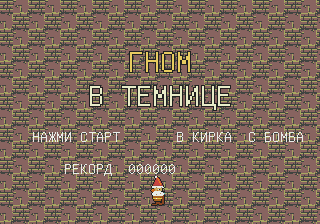
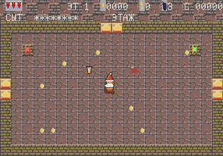
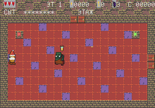

# Гном в темнице

Роглайк для **Sega Mega Drive / Genesis**. Гном попал в темницу гоблинов: бродит по процедурным этажам, собирает золото, открывает двери и бьётся с королём гоблинов.

Ориентиры: Pac-Man, Fatal Labyrinth, The Legend of Zelda, The Binding of Isaac.





## Как играть

Скачайте ROM `gnom-v-temnice.bin` из [релиза v1.1.0](https://github.com/ivanivorontsov-sudo/gnom-v-temnice/releases/tag/v1.1.0) и откройте его в эмуляторе.

- **На компьютере:** [BlastEm](https://www.retrodev.com/blastem/), Genesis Plus GX, RetroArch (ядро Genesis Plus GX).
- **На телефоне:** MD.emu, RetroArch с ядром Genesis Plus GX. Импортируйте `.bin` и запускайте как игру Sega Mega Drive.
- В браузере: страница проекта на GitHub Pages с встроенным эмулятором.

Все надписи в игре на русском.

## Что нового в 1.1.0

- Гном перерисован: высокий красный колпак, большая белая борода, нос, кирка.
- Открытые двери светятся и их лучше видно; закрытые и запертые отличаются.
- Комнаты проверяются на связность, ключ нельзя оставить за дверью короля, застрявшие враги больше не блокируют выход.
- Враги используют разные спрайты (гоблины, орки, шаманы), хитбокс совпадает с картинкой.
- Шкала сытости всегда на экране: предупреждение «ХОЧЕТСЯ ЕСТЬ» / «ГОЛОД» до урона от голода, еды больше, голод растёт медленнее.
- При переходе между комнатами короткая неуязвимость, при уроне — вспышка и звук.


## Управление

| Кнопка | Действие |
|--------|----------|
| Крест | Движение (8 направлений) |
| A / B | Удар киркой |
| C | Поставить бомбу |
| Start | Начать игру, пауза |

## Что есть в игре

- Титульный экран и процедурные этажи в духе Isaac: сетка комнат, 8–12 помещений на этаж.
- Двери закрываются, пока комната не зачищена.
- Гоблины, орки и шаманы с разным поведением: преследователи, засадчики, бродяги, лучники и шаманы.
- Золото и самоцветы (в том числе самоцвет силы — враги в панике, как призраки в Pac-Man).
- Ключ от покоев короля, комнаты с пассивными предметами.
- Босс — король гоблинов; лестница на следующий этаж (3 этажа, сложность растёт).
- Сердца, бомбы, сытость: шкала «СЫТ» всегда на экране, предупреждение и звук перед уроном от голода.
- Перманентная смерть, счёт и рекорд в SRAM.
- Три этажа, затем выход из темницы.

## Сборка

Нужны [SGDK](https://github.com/Stephane-D/SGDK) 2.11 и кросс-компилятор `m68k-*-gcc`. Библиотеку `libmd.a` лучше собрать **без LTO** тем же GCC, которым собирается игра (у релизов SGDK LTO от другого GCC ломает линковку).

```bash
export GDK=/path/to/SGDK
make
# ROM: out/rom.bin
```

Графику и звук можно пересобрать скриптом `tools/convert_assets.py` (нужны исходные наборы, см. `THIRD_PARTY.md`).

## Лицензии сторонних материалов

Собственной лицензии у этого репозитория нет. Обязательные кредиты SGDK, ассетов и шрифта собраны в [THIRD_PARTY.md](THIRD_PARTY.md).
